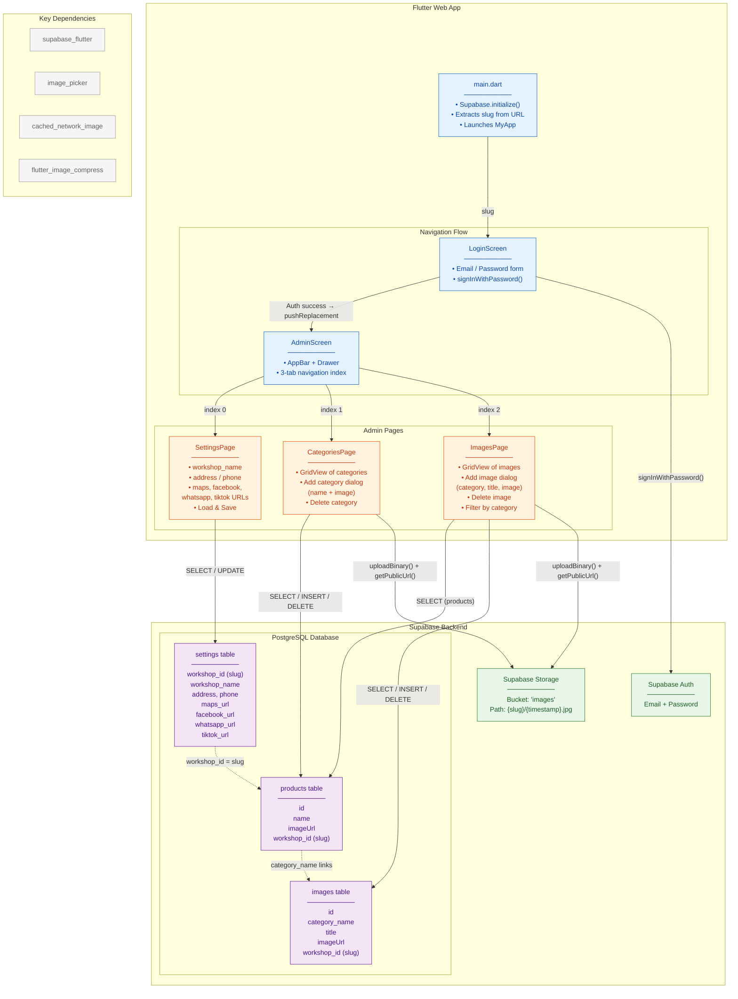
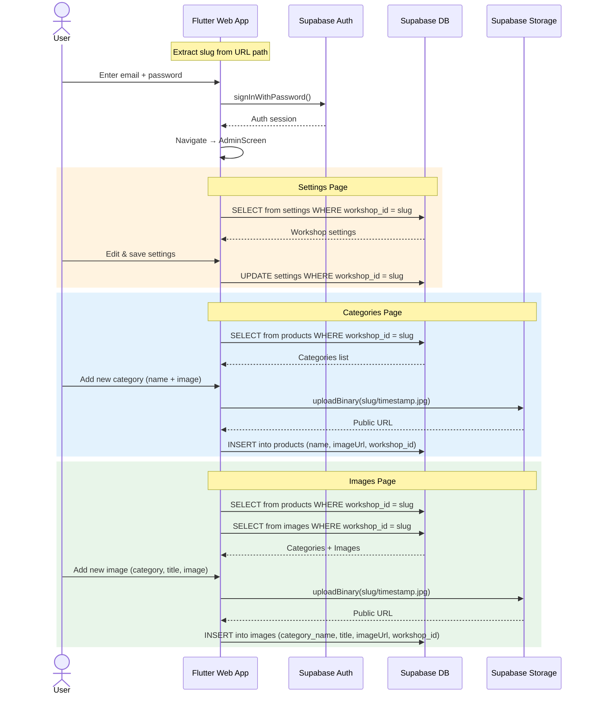
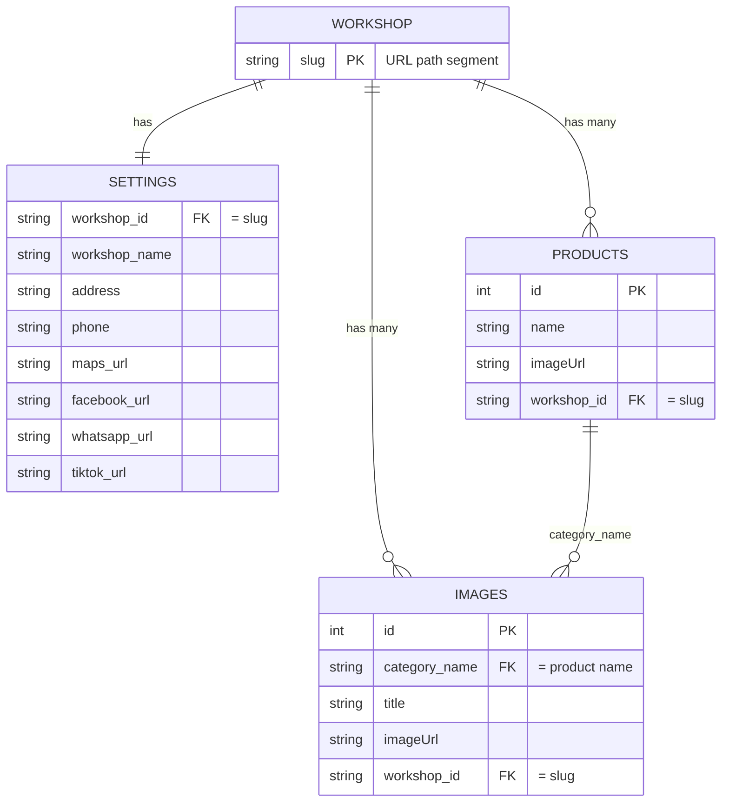
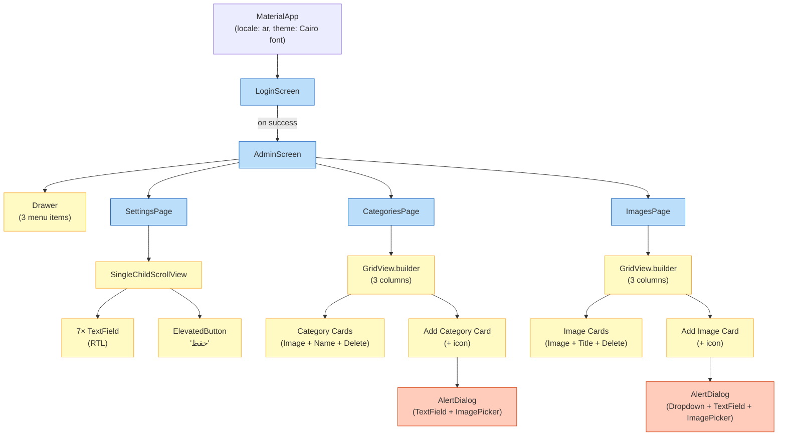

# AluWeb Admin — System Architecture

## System Overview

**AluWeb Admin** is a multi-tenant Flutter Web admin panel for managing workshop portfolios (aluminum workshops / ورش ألمونيوم). Each workshop is identified by a URL **slug** and has its own settings, product categories, and image gallery — all backed by **Supabase** (Auth, Database, Storage).

---

## Architecture Diagram

---

## Component Interaction Sequence

---

## Data Model (ER Diagram)

---

## Widget Tree

> [!NOTE]
> The project uses a **soft foreign key** pattern: `images.category_name` references `products.name` by value rather than by `products.id`. The `workshop_id` (slug) acts as the multi-tenancy discriminator across all three tables.
